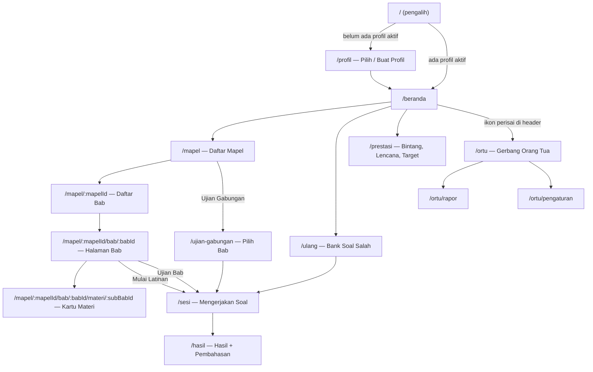

# Siap Kelas 3: Rencana Implementasi Lengkap

> **Untuk agen pelaksana:** Baca bagian **0. Aturan Main Agen** sampai selesai sebelum melakukan apa pun. Dokumen ini adalah satu-satunya sumber kebenaran. Kalau ada yang tidak tertulis di sini, **jangan ditebak**. Catat di `docs/PROGRESS.md` bagian "Pertanyaan Terbuka", lalu tanyakan ke user.

**Tujuan:** Web app (PWA, bisa offline) untuk anak kelas 3 SD belajar materi dan latihan soal persiapan ulangan (ulangan harian, PTS, PAS). Mata pelajaran awal: **PAI** dan **Bahasa Inggris**.

**Arsitektur singkat:** SPA React tanpa backend. Isi pelajaran (mapel → bab → sub-bab → materi + soal) berupa file TypeScript di `src/content/`. Progres anak disimpan di `localStorage` lewat Zustand `persist` dengan pembungkus aman (`safeStorage`). Deploy statis ke Vercel.

**Stack:** Vite + React 19 + TypeScript, Tailwind CSS v4, `motion` (Framer Motion), `lucide-react`, `react-router-dom` v7, `zustand`, `zod`, `vite-plugin-pwa`, `@vercel/analytics`, Vitest, Playwright.

Dokumen pendamping (wajib dibaca sesuai sesi):
- `docs/CONTENT_GUIDE.md`: cara mengubah bahan guru menjadi file isi (wajib untuk sesi konten).
- `docs/PROGRESS.md`: papan progres dan log antar sesi (wajib dibaca di awal **setiap** sesi dan diperbarui di akhir).

---

## 0. Aturan Main Agen (WAJIB)

1. **Awal sesi:** buka `docs/PROGRESS.md`, cari sesi pertama berstatus `[ ]`, kerjakan **hanya sesi itu**. Jangan merangkap beberapa sesi (kuota user terbatas).
2. **Akhir sesi:** semua perintah di bagian "Verifikasi" sesi tersebut harus lulus. Setelah itu centang sesi di `PROGRESS.md`, isi log, lalu `git commit` dan `git push`.
3. **Jangan menambah fitur** yang tidak ada di dokumen ini. Jangan mengganti library.
4. **Semua teks antarmuka berbahasa Indonesia**, ramah anak, kalimat pendek.
5. **Dilarang:** emoji sebagai ikon (pakai `lucide-react`), "Lorem ipsum", teks contoh di build produksi, nama/skor palsu, `href="#"`, gradien ungu-biru, font Inter/Roboto/sistem sebagai font judul.
6. **Shell Windows PowerShell:** `npm`/`npx` diblokir oleh execution policy. **Selalu** pakai `npm.cmd` dan `npx.cmd` (contoh: `npm.cmd run build`). Jangan menjalankan dev server sebagai proses latar yang ditunggu tanpa batas. Untuk tes browser, Playwright sudah menyalakan server sendiri (lihat S0).
7. **ID isi tidak boleh berubah.** ID soal/bab/sub-bab yang sudah di-commit tidak boleh diganti nomornya atau dipakai ulang, karena progres anak tersimpan berdasarkan ID.
8. Kalau perintah gagal 3× dengan cara yang sama, berhenti. Tulis error lengkapnya di `PROGRESS.md` → "Pertanyaan Terbuka", lalu laporkan ke user.
9. Folder proyek: **`D:\!AGY\siap-kelas3`**. Jangan membuat proyek di tempat lain.

---

## 1. Keputusan Produk (hasil wawancara, sudah final)

| # | Topik | Keputusan |
|---|---|---|
| 1 | Pengguna | Anak dalam 1 keluarga (kakak-adik). **Beberapa profil di 1 perangkat**, maksimal 5 profil. Tanpa login, tanpa server |
| 2 | Cakupan kelas | **Khusus kelas 3.** Tidak perlu fitur pilih kelas |
| 3 | Tujuan utama | **Persiapan ulangan/ujian sekolah** |
| 4 | Ujian | **Ujian Bab** (20 soal, 30 menit) + **Ujian Gabungan** beberapa bab pilihan (25 soal, 30 menit). Pembahasan muncul di akhir |
| 5 | Suara | Anak sudah bisa membaca. Tombol **"Bacakan"** (Web Speech API) tersedia di materi dan soal sebagai bantuan |
| 6 | Motivasi | **Bintang per bab + lencana + target harian 10 soal + hari beruntun.** Tanpa koin/toko |
| 7 | Orang tua | **Area Orang Tua** dikunci soal perkalian (2 digit × 1 digit). Isinya rapor, kelola profil, reset data, dan daftar "kunci perlu dicek" |
| 8 | Tema | **Mode Terang default**, ada tombol ganti ke Mode Gelap (tersimpan) |
| 9 | Soal bergambar | **Selalu pakai potongan (crop) foto asli** dari bahan guru |
| 10 | Kunci guru | Soal guru diketik **persis**. Kunci guru dipakai. Kunci yang diduga salah **tetap dipakai**, tapi diberi `catatanKunci` dan muncul di Area Orang Tua |
| 11 | Soal tambahan | Agen membuat soal tambahan **hanya dari modul**. Bahan berupa latihan soal tidak dibuatkan "kembaran". Semua soal guru berlabel **"Soal Guru"** dan bisa difilter (Soal Guru saja / Semua) |
| 12 | Mapel awal | **PAI** dan **Bahasa Inggris**. Bahan berupa PDF, foto/scan, dan Word |
| 13 | Tulisan Arab | Diketik ulang sebagai **teks Arab berharakat** (font khusus), disertai latin dan arti. **Tanpa tombol bacakan untuk teks Arab** |
| 14 | Bahasa Inggris | Tombol dengar pengucapan (`en-US`) + soal **"Dengarkan lalu pilih"**. Petunjuk dan pembahasan **berbahasa Indonesia** |
| 15 | Alamat | Link gratis Vercel dulu (`siap-kelas3-*.vercel.app`), domain menyusul |
| 16 | Offline | **PWA**: bisa dipasang di layar HP dan berjalan offline setelah dibuka sekali |
| 17 | Nama | Nama kerja **"Siap Kelas 3"**. Di sesi S12 agen menawarkan 3 opsi nama ke user |
| 18 | Perangkat | **HP Android 360–420px** sebagai utama, tetap rapi di tablet dan laptop |
| 19 | Cara kerja | Dipecah **per sesi kecil**. Setiap sesi diakhiri verifikasi, commit, dan update `PROGRESS.md` |

### Di luar cakupan (JANGAN dibuat)
Login/akun, database online, mode guru/upload soal, koin/toko/avatar berbayar, papan peringkat, pilih kelas, multi-bahasa antarmuka.

---

## 2. Alur Layar & Navigasi



### Aturan navigasi (wajib di semua layar)
- **`AppHeader`** ada di semua layar: tombol **Kembali** (ikon `ArrowLeft`, area sentuh ≥ 48×48 px, ada `aria-label="Kembali"`) di kiri, **judul halaman** di tengah/kiri, aksi di kanan. Pengecualian: di `/beranda` tombol Kembali diganti logo app.
- **`MobileBottomNav`** (4 tab, selalu tampil kecuali di `/sesi` dan `/profil`): `Beranda` (`Home`), `Mapel` (`BookOpen`), `Ulang` (`RotateCcw`, dengan badge jumlah soal salah), `Prestasi` (`Trophy`). Di layar ≥ 1024px, bottom nav tetap dipakai dengan lebar konten maksimal 480px di tengah (gaya "app di tengah layar"). Ini disengaja agar tetap sederhana.
- **Tombol Kembali** memanggil `navigate(-1)` jika ada riwayat (`window.history.state?.idx > 0`). Jika tidak ada, kembali ke parent route yang ditentukan lewat prop `backTo` di `AppHeader`.
- **Keluar dari `/sesi`** (tombol Kembali atau ikon `X`) membuka dialog: "Simpan dan keluar? Nanti bisa dilanjutkan." dengan tombol **[Lanjut Mengerjakan]** dan **[Simpan & Keluar]**. Progres sudah tersimpan otomatis, jadi tombol ini hanya pindah halaman.
- **Tidak boleh ada halaman buntu.** Halaman kosong, hasil, error, dan 404 selalu punya tombol primer ("Ke Beranda" / "Kembali ke Bab").
- **Semua dialog/bottom sheet:** ada tombol `X`, tombol "Batal", bisa ditutup dengan tap di luar, dan tombol `Esc`.

### Rincian tiap layar

| Route | Judul | Isi | Kosong/Error |
|---|---|---|---|
| `/profil` | "Siapa yang belajar?" | Grid kartu profil (avatar + nama). Kartu "+ Tambah Profil" (sembunyi jika sudah 5). Tap profil → set aktif → `/beranda` | Belum ada profil: langsung tampilkan form buat profil |
| `/profil/baru` | "Profil Baru" | Input nama (1–20 huruf/spasi, divalidasi zod, pesan: "Tulis nama dulu ya" / "Nama maksimal 20 huruf"), pilih avatar (12 pilihan), tombol "Simpan" | - |
| `/beranda` | logo + "Hai, {nama}!" | (1) Kartu **Target Hari Ini** (cincin progres x/10 + hari beruntun). (2) Kartu **Lanjutkan** jika ada sesi aktif. (3) Daftar mapel (kartu horizontal besar, warna mapel, bar progres penguasaan). (4) Kartu **Ulang Soal Salah** jika ada. Header kanan: tombol tema + ikon `ShieldCheck` (Area Orang Tua) + avatar (ganti profil → `/profil`) | - |
| `/mapel` | "Mata Pelajaran" | Daftar kartu mapel + tombol "Ujian Gabungan" | - |
| `/mapel/:mapelId` | nama mapel | Breadcrumb `Beranda › {Mapel}`. Daftar bab: nomor, judul, bintang 0–3, bar penguasaan % | ID salah → komponen `NotFound` |
| `/mapel/:mapelId/bab/:babId` | judul bab | Breadcrumb. Tab (`layoutId` animasi): **Materi** (daftar sub-bab → kartu materi) / **Latihan** / **Ujian**. Tab Latihan: filter `Semua soal` / `Soal Guru saja` (segmented control), info jumlah soal, tombol "Mulai Latihan (10 soal)". Tab Ujian: info "20 soal · 30 menit", nilai terbaik, tombol "Mulai Ujian Bab". Tab aktif disimpan per bab | Bab tanpa soal: "Soal untuk bab ini belum tersedia." + tombol Kembali |
| `.../materi/:subBabId` | judul sub-bab | Kartu materi bisa digeser (drag-x) + tombol Sebelumnya/Berikutnya + indikator titik. Tombol "Bacakan" di tiap kartu (kecuali blok Arab). Kartu terakhir: tombol "Latihan Sub-bab Ini" dan "Kembali ke Bab". Posisi kartu terakhir disimpan | - |
| `/ujian-gabungan` | "Ujian Gabungan" | Pilih mapel (segmented), centang bab (minimal 1), info "25 soal · 30 menit", tombol "Mulai" (nonaktif jika belum ada yang dicentang) | - |
| `/sesi` | jenis sesi + "Soal x/y" | Lihat bagian 6 | Tidak ada sesi aktif → `Navigate` ke `/beranda` |
| `/hasil` | "Hasil" | Nilai besar (0–100) + animasi bintang, ringkasan benar/salah, tombol "Lihat Pembahasan" (daftar semua soal + jawaban anak + kunci + pembahasan), "Ulangi yang Salah", "Kembali ke Bab", "Ke Beranda" | Tidak ada `sesiTerakhir` → ke `/beranda` |
| `/ulang` | "Ulang Soal Salah" | Jumlah soal di bank salah per mapel + tombol "Ulangi (maks 10 soal)" per mapel | Kosong: ilustrasi ikon `PartyPopper` + "Hebat! Tidak ada soal yang perlu diulang." + tombol "Ke Mapel" |
| `/prestasi` | "Prestasi" | Target harian, kalender 14 hari (kotak berwarna sesuai jumlah soal), daftar lencana (terkunci = abu-abu + syarat), bintang per mapel | - |
| `/ortu` | "Area Orang Tua" | Soal perkalian acak `a × b` (a = 12..29, b = 3..9) + input angka. Benar → `sessionStorage` `sk3:ortu=1` → `/ortu/rapor`. Salah → goyang + soal baru | - |
| `/ortu/rapor` | "Rapor {nama}" | Pilih profil (dropdown). Ringkasan per mapel; per bab: bar penguasaan + nilai ujian terbaik; label **"Perlu diulang"** jika penguasaan < 70%; 10 soal paling sering salah; riwayat 20 sesi terakhir; aktivitas 14 hari | Belum ada aktivitas: "Belum ada latihan. Ajak {nama} mulai dari menu Mapel." |
| `/ortu/pengaturan` | "Pengaturan" | Ubah nama/avatar profil, hapus profil (dialog konfirmasi), kecepatan suara (0.8/1/1.2), Bacakan aktif/nonaktif, tema, **"Kunci Perlu Dicek"** (daftar soal ber-`catatanKunci`), **"Reset Semua Data"** (2 langkah: dialog → ketik `HAPUS`), info versi | - |
| `*` | "Halaman tidak ditemukan" | Ikon `MapPinOff` animasi bergoyang + teks ramah + tombol "Ke Beranda" | - |

Semua route `/ortu/*` selain `/ortu` dibungkus guard: jika `sessionStorage.getItem('sk3:ortu') !== '1'` (dengan try/catch), arahkan ke `/ortu`.

---

## 3. Struktur Folder Akhir

```
D:\!AGY\siap-kelas3\
├── bahan\                      # BAHAN ASLI GURU — di .gitignore, JANGAN di-commit
│   ├── pai\  (pdf/jpg/docx asli)  └── _ekstrak\ (hasil ekstraksi teks & render halaman)
│   └── inggris\ ...
├── content-notes\              # di-commit: inventaris & catatan pengolahan per mapel
│   ├── pai\inventaris.md
│   └── inggris\inventaris.md
├── docs\  PLAN.md  CONTENT_GUIDE.md  PROGRESS.md
├── public\
│   ├── img\soal\<mapelId>\<soalId>.webp   # potongan gambar soal/materi
│   ├── favicon.svg  robots.txt  sitemap.xml  (ikon PWA hasil generator)
├── tools\  ekstrak.py  crop.py  render_pdf.py
├── src\
│   ├── main.tsx  App.tsx  router.tsx  index.css
│   ├── content\
│   │   ├── types.ts            # tipe isi (bagian 4)
│   │   ├── index.ts            # registri semua mapel
│   │   ├── helpers.ts          # cariMapel, cariBab, semuaSoalBab, dll
│   │   ├── pai\index.ts  pai\bab-01.ts ...
│   │   └── inggris\index.ts  inggris\bab-01.ts ...
│   ├── lib\
│   │   ├── safeStorage.ts  motion.ts  tts.ts  rng.ts  tanggal.ts  analytics.ts
│   ├── engine\
│   │   ├── periksa.ts          # cek jawaban per tipe
│   │   ├── pilihSoal.ts        # algoritma pemilihan soal
│   │   ├── nilai.ts            # skor, bintang, penguasaan
│   │   └── lencana.ts          # definisi & evaluasi lencana
│   ├── store\  useApp.ts  usePref.ts  types.ts
│   ├── components\
│   │   ├── ui\  Button.tsx IconButton.tsx Card.tsx Dialog.tsx Segmented.tsx ProgressBar.tsx ProgressRing.tsx Stars.tsx Badge.tsx
│   │   ├── layout\  AppHeader.tsx MobileBottomNav.tsx PageShell.tsx Breadcrumbs.tsx ThemeToggle.tsx ErrorBoundary.tsx Seo.tsx
│   │   ├── materi\  KartuMateri.tsx BlokRenderer.tsx TeksArab.tsx TombolBacakan.tsx
│   │   └── soal\  SoalView.tsx SoalPG.tsx SoalBS.tsx SoalIsian.tsx SoalJodohkan.tsx SoalUrutkan.tsx SoalUraian.tsx Pembahasan.tsx GambarSoal.tsx
│   └── pages\  Profil.tsx ProfilBaru.tsx Beranda.tsx MapelList.tsx BabList.tsx BabDetail.tsx Materi.tsx UjianGabungan.tsx Sesi.tsx Hasil.tsx Ulang.tsx Prestasi.tsx OrtuGerbang.tsx OrtuRapor.tsx OrtuPengaturan.tsx NotFound.tsx
├── tests\
│   ├── unit\  (vitest)   ├── content\validasi.test.ts   └── e2e\ (playwright)
├── index.html  vite.config.ts  vercel.json  playwright.config.ts  tsconfig*.json  package.json  .gitignore  README.md
```

---

## 4. Model Data Isi (`src/content/types.ts`)

Salin persis kode berikut:

```ts
export type Level = 'mudah' | 'sedang' | 'menantang';
export type Sumber = 'guru' | 'buatan';

interface SoalDasar {
  id: string;                 // format: <mapel>-b<NN>-s<NN>-q<NNN>, contoh "pai-b01-s02-q007"
  pertanyaan: string;         // teks soal (boleh kosong "" jika soal murni gambar + arab)
  arab?: string;              // teks Arab berharakat yang menjadi bagian soal (opsional)
  gambar?: string;            // path dari /public, contoh "/img/soal/pai/pai-b01-s02-q007.webp"
  gambarAlt?: string;         // deskripsi gambar untuk pembaca layar (wajib jika ada gambar)
  audio?: { teks: string; lang: 'en-US' | 'id-ID' }; // untuk soal "Dengarkan lalu pilih"
  petunjuk?: string;          // bantuan sebelum menjawab, tidak membocorkan jawaban
  pembahasan: string[];       // langkah penjelasan, minimal 1 butir
  level: Level;
  sumber: Sumber;
  rujukan?: string;           // asal soal guru, contoh "LKS PAI hal. 12 no. 5"
  catatanKunci?: string;      // diisi jika kunci guru diduga salah (lihat CONTENT_GUIDE)
}

export interface SoalPG extends SoalDasar {
  tipe: 'pg';
  pilihan: string[];          // 2–4 opsi teks (boleh "" jika pakai pilihanGambar)
  pilihanGambar?: string[];   // opsional, panjang sama dengan pilihan
  kunci: number;              // indeks pilihan yang benar (0-based)
}
export interface SoalBS extends SoalDasar { tipe: 'bs'; kunci: boolean; }
export interface SoalIsian extends SoalDasar {
  tipe: 'isian';
  kunci: string[];            // semua variasi jawaban yang diterima
}
export interface SoalJodohkan extends SoalDasar {
  tipe: 'jodohkan';
  pasangan: { kiri: string; kanan: string }[]; // 3–5 pasang, urutan di sini = pasangan benar
}
export interface SoalUrutkan extends SoalDasar {
  tipe: 'urutkan';
  urutanBenar: string[];      // 3–6 item, urutan di sini = jawaban benar
}
export interface SoalUraian extends SoalDasar {
  tipe: 'uraian';
  contohJawaban: string;      // tidak dinilai otomatis
}

export type Soal = SoalPG | SoalBS | SoalIsian | SoalJodohkan | SoalUrutkan | SoalUraian;
export type TipeSoal = Soal['tipe'];

export type Blok =
  | { jenis: 'paragraf'; teks: string }
  | { jenis: 'poin'; item: string[] }
  | { jenis: 'ingat'; teks: string }                       // kotak "Ingat ya!"
  | { jenis: 'contoh'; teks: string }                      // kotak "Contoh"
  | { jenis: 'arab'; arab: string; latin: string; arti: string }
  | { jenis: 'kosakata'; item: { en: string; id: string; gambar?: string }[] }
  | { jenis: 'gambar'; src: string; alt: string; keterangan?: string };

export interface KartuMateri { id: string; judul: string; isi: Blok[] }

export interface SubBab {
  id: string;                 // "pai-b01-s01"
  judul: string;
  materi: KartuMateri[];      // boleh [] jika bahan hanya latihan soal
  soal: Soal[];
}
export interface Bab {
  id: string;                 // "pai-b01"
  nomor: number;
  judul: string;
  subBab: SubBab[];
}
export interface Mapel {
  id: 'pai' | 'inggris' | string;
  nama: string;               // "Pendidikan Agama Islam"
  namaPendek: string;         // "PAI"
  ikon: 'MoonStar' | 'Languages' | string; // nama ikon lucide
  warna: string;              // token warna, lihat bagian 7
  bab: Bab[];
}

/** Tipe yang dinilai otomatis (uraian tidak). */
export const TIPE_DINILAI: TipeSoal[] = ['pg', 'bs', 'isian', 'jodohkan', 'urutkan'];
```

`src/content/index.ts`:
```ts
import type { Mapel } from './types';
import { pai } from './pai';
import { inggris } from './inggris';
export const SEMUA_MAPEL: Mapel[] = [pai, inggris];
```

`src/content/helpers.ts` menyediakan fungsi berikut (semuanya murni, tanpa efek samping):
`cariMapel(id)`, `cariBab(mapelId, babId)`, `cariSubBab(subBabId)`, `cariSoal(soalId)` (gunakan `Map` yang dibangun sekali), `soalBab(bab, filter: 'semua'|'guru')`, `soalDinilai(soal[])`, `mapelDariSoalId(soalId)` (ambil bagian sebelum `-b`), `babIdDariSoalId(soalId)` (contoh: `"pai-b01-s02-q007"` → `"pai-b01"`).

Sebelum konten asli ada (S4–S10), `src/content/pai/index.ts` dan `inggris/index.ts` diisi `bab: []`. Data uji disimpan di `src/content/__uji__/mapelUji.ts` (id mapel `uji`) dan **hanya** dimuat saat build mode e2e (lihat S6 langkah 5), sehingga tidak pernah tampil di build produksi. Halaman Mapel dengan `bab: []` menampilkan "Materi sedang disiapkan." + tombol Kembali.

---

## 5. Model Data Progres (`src/store/types.ts`)

```ts
export interface Profil { id: string; nama: string; avatar: AvatarId; dibuat: number }
export type AvatarId = 'Cat'|'Dog'|'Rabbit'|'Bird'|'Fish'|'Turtle'|'Rocket'|'Star'|'Sun'|'Moon'|'Flower2'|'TreePine';

export interface StatSoal {
  benar: number;
  salah: number;
  terakhir: 'benar' | 'salah';
  beruntunBenar: number;      // jumlah benar berturut-turut terakhir
  diBankSalah: boolean;
  ts: number;                 // terakhir dijawab (ms)
}

export type JenisSesi = 'latihan' | 'ujian-bab' | 'ujian-gabungan' | 'ulang';

export type Jawaban =
  | { tipe: 'pg'; pilih: number }                       // indeks ASLI di soal.pilihan
  | { tipe: 'bs'; nilai: boolean }
  | { tipe: 'isian'; teks: string }
  | { tipe: 'jodohkan'; pasangan: Record<number, number> } // kiri idx -> kanan idx (asli)
  | { tipe: 'urutkan'; urutan: number[] }               // indeks ASLI urutanBenar
  | { tipe: 'uraian'; cocok: boolean | null };

export interface Sesi {
  id: string;
  jenis: JenisSesi;
  mapelId: string;
  babIds: string[];
  filter: 'semua' | 'guru';
  soalIds: string[];
  acak: Record<string, number[]>;   // urutan tampilan opsi/kanan/item per soal (permutasi indeks asli)
  jawaban: Record<string, Jawaban>;
  sudahDicek: string[];             // latihan/ulang: soal yang sudah diperiksa
  ragu: string[];                   // ujian: ditandai ragu-ragu
  indeks: number;
  mulai: number;
  batasWaktu: number | null;        // timestamp ms (ujian), null untuk latihan
  selesai: boolean;
}

export interface RingkasanSesi {
  id: string; jenis: JenisSesi; mapelId: string; babIds: string[];
  nilai: number; benar: number; total: number; ts: number;
}

export interface ProgresProfil {
  soal: Record<string, StatSoal>;
  sesiAktif: Sesi | null;           // hanya 1 sesi aktif per profil
  sesiTerakhir: Sesi | null;        // sesi selesai terakhir (untuk halaman Hasil)
  riwayat: RingkasanSesi[];         // maksimal 50, terbaru di depan
  harian: Record<string, number>;   // "YYYY-MM-DD" (zona lokal) -> jumlah soal dijawab
  lencana: Record<string, number>;  // lencanaId -> ts didapat
  ujianBabTerbaik: Record<string, number>; // babId -> nilai terbaik
  tabBab: Record<string, 'materi'|'latihan'|'ujian'>;
  posisiMateri: Record<string, number>;    // subBabId -> indeks kartu
  hitung: { dengarBenar: number; salahDibersihkan: number };
}

export interface DataApp {
  profilAktifId: string | null;
  profil: Profil[];
  progres: Record<string, ProgresProfil>;
}
```

### Kunci `localStorage` (prefix `sk3:`)
| Kunci | Isi |
|---|---|
| `sk3:data` | `DataApp` (Zustand persist, `version: 1`) |
| `sk3:pref` | `{ suaraAktif: boolean, kecepatan: 0.8 \| 1 \| 1.2 }` (Zustand persist) |
| `sk3:tema` | string `'terang'` atau `'gelap'` (dibaca oleh skrip boot di `<head>`) |
| `sessionStorage sk3:ortu` | `'1'` setelah lolos gerbang orang tua |

### `src/lib/safeStorage.ts` (salin persis)
```ts
import type { StateStorage } from 'zustand/middleware';

const memori = new Map<string, string>();

function ls(): Storage | null {
  try { const s = window.localStorage; const k = '__sk3_tes__'; s.setItem(k, '1'); s.removeItem(k); return s; }
  catch { return null; }
}

export const safeStorage: StateStorage = {
  getItem: (key) => { try { return ls()?.getItem(key) ?? memori.get(key) ?? null; } catch { return memori.get(key) ?? null; } },
  setItem: (key, value) => { memori.set(key, value); try { ls()?.setItem(key, value); } catch { /* penuh/privat: tetap di memori */ } },
  removeItem: (key) => { memori.delete(key); try { ls()?.removeItem(key); } catch { /* abaikan */ } },
};

export function bersihkanSemua(): void {
  memori.clear();
  try {
    const s = ls(); if (!s) return;
    Object.keys(s).filter((k) => k.startsWith('sk3:')).forEach((k) => s.removeItem(k));
  } catch { /* abaikan */ }
  try { window.sessionStorage.removeItem('sk3:ortu'); } catch { /* abaikan */ }
}
```

Jika JSON di `sk3:data` rusak, Zustand `persist` akan melempar error saat hydrate. Tangani dengan opsi `onRehydrateStorage: () => (_s, err) => { if (err) safeStorage.removeItem('sk3:data'); }` dan `merge` yang memvalidasi bentuk minimal (ada array `profil`). Jika tidak valid, pakai state awal.

### Aksi store `useApp` (Zustand + `persist` + `createJSONStorage(() => safeStorage)`)
`buatProfil(nama, avatar)`, `pilihProfil(id)`, `ubahProfil(id, data)`, `hapusProfil(id)`, `mulaiSesi(sesi)`, `jawab(soalId, jawaban)`, `cekJawaban(soalId)` (latihan/ulang: memperbarui `StatSoal` + `harian` + lencana), `pindahSoal(indeks)`, `tandaiRagu(soalId)`, `selesaikanSesi()` (ujian: perbarui semua `StatSoal` sekaligus, hitung nilai, isi `riwayat`, `ujianBabTerbaik`, `sesiTerakhir`, lalu `sesiAktif = null`), `batalkanSesi()`, `setTabBab`, `setPosisiMateri`, `resetSemua()` (memanggil `bersihkanSemua()` lalu set state awal).

Aturan pembaruan `StatSoal` saat jawaban diperiksa (hanya tipe dinilai):
```ts
function perbaruiStat(lama: StatSoal | undefined, benar: boolean, now: number): StatSoal {
  const s = lama ?? { benar: 0, salah: 0, terakhir: 'salah', beruntunBenar: 0, diBankSalah: false, ts: now };
  if (benar) {
    const beruntun = s.beruntunBenar + 1;
    return { ...s, benar: s.benar + 1, terakhir: 'benar', beruntunBenar: beruntun,
             diBankSalah: s.diBankSalah && beruntun < 2, ts: now };
  }
  return { ...s, salah: s.salah + 1, terakhir: 'salah', beruntunBenar: 0, diBankSalah: true, ts: now };
}
```
Saat `diBankSalah` berubah dari `true` ke `false`, naikkan `hitung.salahDibersihkan`. Soal tipe `uraian` tidak memperbarui `StatSoal`, tapi tetap menambah `harian`.

---

## 6. Mesin Soal

### 6.1 Pemeriksaan jawaban (`src/engine/periksa.ts`)
```ts
export function normalisasi(t: string): string {
  return t.toLowerCase().normalize('NFKC').replace(/[.,!?;:"'`]/g, '').replace(/\s+/g, ' ').trim();
}
export function periksa(soal: Soal, j: Jawaban): boolean | null {
  switch (soal.tipe) {
    case 'pg': return j.tipe === 'pg' && j.pilih === soal.kunci;
    case 'bs': return j.tipe === 'bs' && j.nilai === soal.kunci;
    case 'isian': return j.tipe === 'isian' && soal.kunci.some((k) => normalisasi(k) === normalisasi(j.teks));
    case 'jodohkan': return j.tipe === 'jodohkan' && soal.pasangan.every((_, i) => j.pasangan[i] === i);
    case 'urutkan': return j.tipe === 'urutkan' && j.urutan.length === soal.urutanBenar.length && j.urutan.every((v, i) => v === i);
    case 'uraian': return null; // tidak dinilai
  }
}
export function jawabanLengkap(soal: Soal, j?: Jawaban): boolean { /* pg/bs: ada; isian: teks tidak kosong;
  jodohkan: semua kiri terpasang; urutkan: panjang = jumlah item; uraian: selalu true */ }
```

### 6.2 Pemilihan soal (`src/engine/pilihSoal.ts`)
`src/lib/rng.ts` menyediakan `buatRng(seed: number)` (mulberry32) dan `acak<T>(arr, rng)` (Fisher–Yates, mengembalikan salinan). Semua fungsi pemilih menerima `rng` agar bisa dites secara deterministik. Di aplikasi pakai `buatRng(Date.now())`.

| Jenis | Kumpulan soal | Jumlah | Urutan prioritas |
|---|---|---|---|
| Latihan bab | Soal bab (filter guru/semua), termasuk uraian | 10 (atau semua jika < 10) | 1) belum pernah dijawab, 2) `diBankSalah`, 3) sisanya, urut dari `ts` terlama. Hasil akhir diacak |
| Latihan sub-bab | Soal sub-bab saja | 10 | sama |
| Ujian bab | Soal dinilai di bab (filter **selalu semua**) | 20 | acak penuh |
| Ujian gabungan | Soal dinilai dari bab terpilih | 25 | bagi proporsional ke tiap bab sesuai jumlah soalnya (`Math.round`, minimal 1 per bab, sesuaikan total ke 25), lalu acak |
| Ulang salah | Soal `diBankSalah` di mapel itu | maks 10 | `ts` terlama dulu |

`acak[soalId]` diisi saat sesi dibuat: pg → permutasi indeks pilihan; jodohkan → permutasi indeks kanan; urutkan → permutasi indeks item, **dijamin tidak sama dengan urutan benar** (acak ulang maksimal 10×). bs/isian/uraian → `[]`.

### 6.3 Nilai, bintang, penguasaan (`src/engine/nilai.ts`)
- `nilai = Math.round(benar / jumlahSoalDinilai * 100)`. Soal yang tidak dijawab saat ujian dihitung salah. Jika jumlah soal dinilai = 0, nilai = 0 dan tampilkan "Sesi ini hanya berisi soal uraian."
- **Bintang bab** dari `ujianBabTerbaik`: ≥ 90 → 3, ≥ 75 → 2, ≥ 60 → 1, selain itu 0.
- **Penguasaan bab (%)** = jumlah soal dinilai di bab dengan `terakhir === 'benar'` ÷ total soal dinilai di bab × 100.
- **Penguasaan mapel** = rata-rata penguasaan bab yang punya soal.

### 6.4 Layar `/sesi` (`pages/Sesi.tsx`)
Tata letak dari atas ke bawah:
1. `AppHeader` dengan judul jenis sesi, tombol `X` (dialog keluar). Untuk ujian, sisi kanan berisi **timer** `mm:ss` (merah dan berdenyut halus saat < 5 menit).
2. Bar progres tipis + teks "Soal 3 dari 10".
3. Kartu soal: label kecil (Soal Guru / level), `TombolBacakan` (membacakan `pertanyaan` + pilihan, `id-ID`; untuk mapel Inggris membacakan teks soal dengan `en-US`), gambar (`GambarSoal`, bisa diketuk untuk memperbesar di dialog), teks Arab (`TeksArab`), lalu komponen jawaban sesuai tipe.
4. Area bawah lengket (sticky, aman dari area jempol):
   - **Latihan/Ulang:** sebelum dicek → tombol **"Petunjuk"** (jika ada, membuka bottom sheet) + **"Periksa"** (nonaktif jika jawaban belum lengkap). Sesudah dicek → panel umpan balik (benar: hijau "Benar! Hebat!" + animasi pop; salah: kartu goyang + "Belum tepat" + jawaban benar) + **`Pembahasan`** terbuka otomatis + tombol **"Lanjut"** / **"Lihat Hasil"** di soal terakhir. Satu soal hanya boleh dijawab satu kali.
   - **Ujian:** tombol **"Sebelumnya"**, **"Ragu-ragu"** (toggle, kuning), **"Berikutnya"**; tombol `Grid` membuka bottom sheet **nomor soal** (hijau = dijawab, kuning = ragu, abu = kosong) untuk loncat. Di soal terakhir: **"Selesai"**, membuka dialog konfirmasi "Masih ada X soal kosong dan Y ragu-ragu. Kumpulkan sekarang?".
5. Timer memakai `batasWaktu` absolut. Hitung ulang setiap 1 detik (`setInterval`) dari `batasWaktu - Date.now()`. Jika ≤ 0, panggil `selesaikanSesi()` otomatis lalu ke `/hasil` dengan toast "Waktu habis, jawabanmu dikumpulkan." Karena memakai waktu absolut, refresh halaman tidak mereset timer.
6. Semua perubahan jawaban langsung masuk store (persist), sehingga refresh di tengah sesi melanjutkan di soal yang sama.

**Memulai sesi saat masih ada `sesiAktif`:** tampilkan dialog "Kamu masih punya {jenis} yang belum selesai." dengan pilihan **[Lanjutkan yang Tadi]** atau **[Mulai Baru]** (yang lama dibuang tanpa dinilai).

### 6.5 Komponen jawaban per tipe (semua berbasis ketuk, tanpa drag, ramah jempol)
| Tipe | UI |
|---|---|
| `pg` | Daftar tombol opsi besar berlabel A/B/C/D (urutan dari `acak`). Terpilih = border tebal warna mapel. Setelah dicek: opsi benar hijau + ikon `Check`, opsi salah yang dipilih merah + ikon `X`. Jika ada `pilihanGambar`: grid 2 kolom berisi gambar + label huruf |
| `bs` | Dua tombol besar **"Benar"** (`Check`) dan **"Salah"** (`X`) |
| `isian` | Input teks besar (`inputMode="text"`, `autoComplete="off"`, `autoCapitalize="none"`). Enter = Periksa |
| `jodohkan` | Dua kolom. Ketuk item kiri (tersorot), lalu ketuk item kanan, sehingga keduanya mendapat warna pasangan yang sama (palet 5 warna) dan nomor kecil. Ketuk pasangan yang sudah jadi untuk melepasnya. Di layar < 400px kolom kanan tetap di sebelah kanan dengan teks dibungkus |
| `urutkan` | Item acak di "kolam" bawah. Ketuk item untuk memindahkannya ke baris jawaban berurutan (bernomor). Ketuk item di baris jawaban untuk mengembalikannya. Ada tombol "Ulang" |
| `uraian` | Teks "Jawab di buku atau ucapkan ke orang tua." Tombol "Lihat Contoh Jawaban" memunculkan `contohJawaban`, lalu pertanyaan "Jawabanmu sudah mirip?" [Sudah] [Belum]. Tidak memengaruhi nilai |
| Soal `audio` | Tombol besar bulat `Volume2` "Dengarkan" di atas pilihan (bisa diputar berulang). Teks `audio.teks` **tidak** ditampilkan sebelum dicek. Setelah dicek, tampilkan teksnya |

### 6.6 Komponen `Pembahasan`
Kotak bertajuk "Cara Mengerjakan" (ikon `Lightbulb`), butir `pembahasan[]` sebagai daftar bernomor, tombol "Bacakan" (`id-ID`). Jika soal punya `catatanKunci`, **jangan tampilkan** catatan itu ke anak (hanya di Area Orang Tua).

---

## 7. Sistem Desain

### 7.1 Font (dipaket lokal lewat Fontsource agar offline)
- Judul/tampilan: **Fredoka** (`@fontsource-variable/fredoka`), bobot 500–700.
- Isi: **Andika** (`@fontsource/andika`, 400 & 700). Font ini dirancang untuk pembaca pemula.
- Arab: **Scheherazade New** (`@fontsource/scheherazade-new`, 400 & 700). Jika paket tidak tersedia, pakai `@fontsource/amiri` dan catat di PROGRESS.
- Ukuran: isi 18px (`text-lg`) dengan line-height 1.6; judul halaman 24px; nilai hasil 64px; teks Arab 30px (`text-[1.875rem]`) dengan line-height 2.2, `dir="rtl"`, `lang="ar"`.

### 7.2 Token warna (`src/index.css`, Tailwind v4 `@theme`)
```css
@import "tailwindcss";
@custom-variant dark (&:where(.dark, .dark *));

@theme {
  --font-display: "Fredoka Variable", "Fredoka", ui-rounded, sans-serif;
  --font-body: "Andika", ui-sans-serif, sans-serif;
  --font-arab: "Scheherazade New", "Amiri", serif;

  --color-krem-50: #FFFBF5;  --color-krem-100: #FFF3E3; --color-krem-200: #F6E7D3;
  --color-tinta-900: #1E1B18; --color-tinta-700: #3D3731; --color-tinta-500: #6B625A;
  --color-malam-950: #14110F; --color-malam-900: #1D1915; --color-malam-800: #2B2520; --color-malam-700: #3A332C;

  --color-jeruk-400: #FF9A4D; --color-jeruk-500: #FF7A1A; --color-jeruk-600: #E2620A; --color-jeruk-700: #B84D06;
  --color-pai-500: #059669;   --color-pai-600: #047857;   --color-pai-100: #D1FAE5;   --color-pai-900: #064E3B;
  --color-ing-500: #0284C7;   --color-ing-600: #0369A1;   --color-ing-100: #E0F2FE;   --color-ing-900: #0C4A6E;

  --color-benar-500: #16A34A; --color-benar-100: #DCFCE7;
  --color-salah-500: #DC2626; --color-salah-100: #FEE2E2;
  --color-ragu-500:  #F59E0B; --color-ragu-100:  #FEF3C7;
}
```
| Peran | Terang | Gelap |
|---|---|---|
| Latar halaman | `krem-50` | `malam-950` |
| Kartu | `#FFFFFF` + border `krem-200` + bayangan lembut hangat | `malam-900` + border `malam-800` |
| Teks utama / sekunder | `tinta-900` / `tinta-500` | `#F5EFE6` / `#B8AEA3` |
| Aksen utama (tombol primer) | `jeruk-500`, teks `tinta-900` (kontras ≥ 4.5) | `jeruk-400`, teks `malam-950` |
| Warna PAI / Inggris (teks) | `pai-600` / `ing-600` | `pai-100` / `ing-100` |

Warna mapel dipakai untuk aksen kartu, bar progres, dan border opsi terpilih. Teks berwarna di atas putih wajib memakai varian `-600`. **Tidak ada gradien ungu-biru.** Latar Beranda memakai pola halus (SVG titik/garis ombak) warna `krem-100` sebagai karakter visual, bukan gradien besar.

### 7.3 Tema & anti-kedip
Di `index.html`, di dalam `<head>` **sebelum** CSS, salin persis:
```html
<script>
  (function () {
    try {
      var gelap = localStorage.getItem('sk3:tema') === 'gelap';
      document.documentElement.classList.toggle('dark', gelap);
      document.documentElement.style.colorScheme = gelap ? 'dark' : 'light';
    } catch (e) {}
  })();
</script>
```
`ThemeToggle` (ikon `Sun`/`Moon` berputar 180° dengan spring saat berganti) menulis `sk3:tema` (try/catch), mengubah class `dark`, serta memperbarui `<meta name="theme-color">` (`#FFFBF5` terang, `#14110F` gelap).

### 7.4 Gerak (`src/lib/motion.ts`)
```ts
import type { Transition, Variants } from 'motion/react';
export const pegas: Transition = { type: 'spring', stiffness: 380, damping: 28 };
export const pegasLembut: Transition = { type: 'spring', stiffness: 300, damping: 30 };
export const tekan = { whileTap: { scale: 0.96 }, whileHover: { y: -2 } } as const;
export const muncul: Variants = { awal: { opacity: 0, y: 12 }, tampil: { opacity: 1, y: 0, transition: pegasLembut } };
export const daftarBertingkat: Variants = { awal: {}, tampil: { transition: { staggerChildren: 0.05 } } };
export const goyang = { x: [0, -10, 10, -6, 6, 0], transition: { duration: 0.35 } };
export const pop = { scale: [1, 1.08, 1], transition: { duration: 0.3 } };
export const geserHalaman: Variants = {
  masuk: { opacity: 0, x: 24 }, tampil: { opacity: 1, x: 0, transition: pegas }, keluar: { opacity: 0, x: -24, transition: { duration: 0.15 } },
};
```
Bungkus app dengan `<MotionConfig reducedMotion="user">`. Ragam gerak wajib (bukan hanya fade-in-up):
1. Transisi halaman geser (`AnimatePresence` di router outlet, key = pathname).
2. Tombol/kartu memantul (`tekan`).
3. Tab dengan indikator `layoutId`.
4. Jawaban benar: `pop` + 8 partikel bintang kecil (`Star` lucide) menyebar dari tombol (komponen `Percikan`, CSS/motion, tanpa library).
5. Jawaban salah: `goyang`.
6. Cincin target harian terisi (animasi `pathLength`).
7. Angka nilai di Hasil berhitung naik 0 → nilai (≈ 800 ms).
8. Kartu materi digeser dengan `drag="x"` + snap.
9. Bar progres terisi saat masuk layar (`whileInView`).

### 7.5 Komponen UI dasar (`components/ui`)
- `Button`: varian `primer | sekunder | hantu | bahaya`, ukuran `md` (tinggi 48px) | `lg` (56px), sudut `rounded-2xl`, font display, `motion.button` + `tekan`, `disabled` (opacity 50%, tanpa animasi), prop `ikonKiri`.
- `IconButton`: 48×48, `aria-label` wajib (dipaksa lewat tipe TypeScript).
- `Card`: `rounded-3xl`, padding 20px, border + bayangan, opsi `interaktif` (hover naik 2px).
- `Dialog`: overlay + panel. Di mobile tampil sebagai bottom sheet (geser dari bawah), di ≥ 640px sebagai modal tengah. Ada `X`, tombol Batal, tap luar, Esc, fokus terkunci (`inert` pada root lain), dan fokus kembali ke pemicu setelah ditutup.
- `Segmented`: pilihan 2–3 opsi dengan indikator `layoutId`.
- `ProgressBar`, `ProgressRing`, `Stars` (0–3, ikon `Star` terisi/garis), `Badge`.
- Fokus terlihat: `focus-visible:outline-3 outline-offset-2 outline-jeruk-500`.

### 7.6 Suara (`src/lib/tts.ts`)
```ts
export function bisaBicara(): boolean { return typeof window !== 'undefined' && 'speechSynthesis' in window; }
export function bicara(teks: string, lang: 'id-ID' | 'en-US', kecepatan = 1): void {
  if (!bisaBicara()) return;
  try {
    window.speechSynthesis.cancel();
    const u = new SpeechSynthesisUtterance(teks.replace(/[\u0600-\u06FF]+/g, ' '));
    u.lang = lang; u.rate = kecepatan;
    const suara = window.speechSynthesis.getVoices().find((v) => v.lang.replace('_', '-').startsWith(lang.slice(0, 2)));
    if (suara) u.voice = suara;
    window.speechSynthesis.speak(u);
  } catch { /* abaikan */ }
}
export function diam(): void { try { window.speechSynthesis?.cancel(); } catch { /* abaikan */ } }
```
`TombolBacakan` disembunyikan jika `!bisaBicara()` atau `pref.suaraAktif === false`. Selama berbicara, ikon berubah menjadi `Square` (stop). Panggil `diam()` saat pindah soal atau halaman.

---

## 8. Motivasi (`src/engine/lencana.ts`)

- **Target harian:** 10 soal dijawab per hari (semua tipe). **Hari beruntun** = jumlah hari berturut-turut hingga hari ini (atau kemarin, jika hari ini belum mencapai target) dengan `harian[hari] >= 10`. Gunakan tanggal lokal (`src/lib/tanggal.ts`: `kunciHari(date)` → `YYYY-MM-DD` dari `getFullYear/getMonth/getDate`).
- **Lencana** (dievaluasi setiap `cekJawaban` dan `selesaikanSesi`). Lencana baru memunculkan toast "Lencana baru: {nama}!" dengan animasi:

| id | Nama | Ikon | Syarat |
|---|---|---|---|
| `langkah-pertama` | Langkah Pertama | `Footprints` | Menjawab 1 soal |
| `rajin-3` | Rajin 3 Hari | `Flame` | Hari beruntun ≥ 3 |
| `rajin-7` | Rajin Seminggu | `CalendarCheck` | Hari beruntun ≥ 7 |
| `nilai-sempurna` | Nilai Sempurna | `Medal` | Nilai 100 di ujian bab/gabungan |
| `penakluk-bab` | Penakluk Bab | `Crown` | 3 bintang di satu bab |
| `pembasmi-salah` | Pembasmi Salah | `Eraser` | `hitung.salahDibersihkan` ≥ 10 |
| `telinga-hebat` | Telinga Hebat | `Ear` | `hitung.dengarBenar` ≥ 10 |
| `seratus-soal` | 100 Soal | `Target` | Total soal dijawab ≥ 100 |

---

## 9. Paket Web Siap Pakai (20 fondasi, disesuaikan untuk SPA tanpa server)

| # | Fondasi | Penerapan |
|---|---|---|
| 1–2 | sitemap & robots | `public/sitemap.xml` berisi `/`, `/mapel`, `/mapel/pai`, `/mapel/inggris`. `public/robots.txt`: `User-agent: *`, `Allow: /`, `Disallow: /ortu`, `Sitemap: <URL>/sitemap.xml`. URL diambil dari konstanta `SITE_URL` di `src/lib/situs.ts`, diperbarui di S12 setelah deploy |
| 3–4 | Search Console | `index.html` berisi `<meta name="google-site-verification" content="%VITE_GSC%">`. Jika `VITE_GSC` kosong, plugin kecil di `vite.config.ts` menghapus tag itu saat build |
| 5–6 | Tautan internal & breadcrumbs | `Breadcrumbs` di BabList, BabDetail, dan Materi (`Beranda › PAI › Bab 1 › …`) |
| 7, 10 | Canonical, meta, OG, Twitter | Komponen `Seo` (title, description, canonical per route) memakai `useEffect` untuk mengubah `document.title` dan `<link rel=canonical>`. OG/Twitter statis di `index.html` dengan gambar `public/og.png` (1200×630, dibuat di S10). `<meta name="robots" content="index, follow">` |
| 8 | LocalBusiness | **Tidak berlaku** (bukan bisnis lokal). Catat "N/A" |
| 9 | Organization JSON-LD | Di `index.html`: `{"@context":"https://schema.org","@type":"Organization","name":"Sekawan Digital","url":"https://sekawandigital.my.id"}` |
| 11 | Tanpa link rusak | Tes e2e mengklik semua tautan bottom nav dan breadcrumb. Dilarang `href="#"` |
| 12 | Validasi form | Form profil (zod) + input gerbang ortu + konfirmasi `HAPUS` |
| 13 | Anti-spam | **Tidak berlaku** (tidak ada data yang dikirim ke server). Catat "N/A" |
| 14, 16 | Pelacakan | `@vercel/analytics` (`<Analytics />`) + `track()` di `src/lib/analytics.ts` (dibungkus try/catch): `profil_dibuat`, `mulai_sesi` {jenis, mapel}, `selesai_sesi` {jenis, nilai}, `klik_cta` {nama}. **Jangan kirim nama anak** |
| 15 | Klik WA | **Tidak berlaku** |
| 17 | Favicon asli | `public/favicon.svg`: logo buatan sendiri (lingkaran jeruk + huruf "3" Fredoka putih + aksen bintang). Ikon PWA dihasilkan dari file ini |
| 18 | 404 interaktif | `NotFound.tsx` (lihat bagian 2) |
| 19 | Cadangan | Push GitHub di setiap sesi, `ErrorBoundary` di root (layar "Ups, ada yang error" + tombol "Muat Ulang" & "Ke Beranda"), `safeStorage` |
| 20 | Semua perangkat | Tes e2e di 360, 412, 768, dan 1280 px: `document.documentElement.scrollWidth <= window.innerWidth` |

---

## 10. Konfigurasi Kunci

### `vite.config.ts`
```ts
import { defineConfig, loadEnv, type Plugin } from 'vite';
import react from '@vitejs/plugin-react';
import tailwindcss from '@tailwindcss/vite';
import { VitePWA } from 'vite-plugin-pwa';

function gscMeta(gsc: string): Plugin {
  return { name: 'gsc-meta', transformIndexHtml: (html) =>
    gsc ? html.replace('%VITE_GSC%', gsc) : html.replace(/\s*<meta name="google-site-verification"[^>]*>/, '') };
}

export default defineConfig(({ mode }) => {
  const env = loadEnv(mode, process.cwd(), '');
  return {
    plugins: [
      react(), tailwindcss(), gscMeta(env.VITE_GSC ?? ''),
      VitePWA({
        registerType: 'autoUpdate',
        includeAssets: ['favicon.svg', 'robots.txt', 'sitemap.xml'],
        workbox: { globPatterns: ['**/*.{js,css,html,svg,png,webp,woff2}'], maximumFileSizeToCacheInBytes: 5 * 1024 * 1024, navigateFallbackDenylist: [/^\/sitemap\.xml$/, /^\/robots\.txt$/] },
        manifest: {
          name: 'Siap Kelas 3', short_name: 'Siap Kelas 3', lang: 'id', start_url: '/', display: 'standalone',
          background_color: '#FFFBF5', theme_color: '#FF7A1A',
          icons: [
            { src: 'pwa-192x192.png', sizes: '192x192', type: 'image/png' },
            { src: 'pwa-512x512.png', sizes: '512x512', type: 'image/png' },
            { src: 'maskable-icon-512x512.png', sizes: '512x512', type: 'image/png', purpose: 'maskable' },
          ],
        },
      }),
    ],
    test: { environment: 'jsdom', include: ['tests/unit/**/*.test.ts?(x)', 'tests/content/**/*.test.ts'], setupFiles: ['tests/setup.ts'] },
  };
});
```
(Tambahkan `/// <reference types="vitest/config" />` di baris pertama agar properti `test` dikenali.)

### `vercel.json`
```json
{
  "rewrites": [{ "source": "/((?!.*\\.).*)", "destination": "/index.html" }],
  "headers": [{ "source": "/(.*)", "headers": [
    { "key": "X-Content-Type-Options", "value": "nosniff" },
    { "key": "X-Frame-Options", "value": "DENY" },
    { "key": "Referrer-Policy", "value": "strict-origin-when-cross-origin" }
  ]}]
}
```

### `playwright.config.ts`
```ts
import { defineConfig, devices } from '@playwright/test';
export default defineConfig({
  testDir: 'tests/e2e',
  use: { baseURL: 'http://localhost:4173', trace: 'retain-on-failure' },
  webServer: { command: 'npm.cmd run build && npm.cmd run preview -- --port 4173 --strictPort', url: 'http://localhost:4173', reuseExistingServer: true, timeout: 180_000 },
  projects: [
    { name: 'hp', use: { ...devices['Pixel 5'], viewport: { width: 360, height: 760 } } },
    { name: 'desktop', use: { ...devices['Desktop Chrome'] } },
  ],
});
```

### Skrip `package.json`
```json
"scripts": {
  "dev": "vite",
  "build": "tsc -b && vite build",
  "preview": "vite preview",
  "typecheck": "tsc -b",
  "test": "vitest run",
  "test:konten": "vitest run tests/content",
  "e2e": "playwright test",
  "ikon": "pwa-assets-generator --preset minimal-2023 public/favicon.svg",
  "cek": "npm.cmd run typecheck && npm.cmd run test && npm.cmd run build"
}
```

### `.gitignore` (tambahan di atas bawaan Vite)
```
bahan/
test-results/
playwright-report/
.env
.env.local
.vercel
```

---

## 11. Rencana Sesi (kerjakan berurutan, satu sesi per giliran)

Format tiap sesi: **Tujuan → Langkah → Verifikasi → Commit.** Perintah "Verifikasi umum" = `npm.cmd run cek` harus lulus.

### S0 — Persiapan proyek & repo
**Tujuan:** proyek kosong yang bisa di-build, sudah ada di GitHub, dan tesnya siap.
1. Folder `D:\!AGY\siap-kelas3` sudah memiliki repo Git dan folder `docs/`. Di dalam `D:\!AGY\siap-kelas3`, inisialisasi proyek Vite tanpa menghapus `docs/` dan `.git/`:
   `npx.cmd create-vite@latest . --template react-ts --no-interactive` (atau buat di subfolder sementara lalu pindahkan `package.json`, `src/`, `index.html`, `tsconfig*.json` ke root `D:\!AGY\siap-kelas3`). Lalu jalankan `npm.cmd install`.
2. Pasang dependensi:
   `npm.cmd i react-router-dom zustand motion lucide-react zod @vercel/analytics @fontsource-variable/fredoka @fontsource/andika @fontsource/scheherazade-new`
   `npm.cmd i -D tailwindcss @tailwindcss/vite vite-plugin-pwa @vite-pwa/assets-generator vitest jsdom @testing-library/react @testing-library/jest-dom @testing-library/user-event @playwright/test`
   `npx.cmd playwright install chromium`
3. Buat `vite.config.ts`, `vercel.json`, `playwright.config.ts`, skrip `package.json`, dan `.gitignore` persis seperti bagian 10. Buat `tests/setup.ts` berisi `import '@testing-library/jest-dom/vitest';`.
4. Hapus isi demo Vite (`App.css`, logo, counter). `App.tsx` sementara menampilkan teks "Siap Kelas 3".
5. Pastikan `docs/PLAN.md`, `docs/CONTENT_GUIDE.md`, `docs/PROGRESS.md`, folder `bahan/pai`, `bahan/inggris`, `content-notes/`, dan `tools/` tetap utuh.
6. Buat tes asap `tests/unit/asap.test.ts` (`expect(1+1).toBe(2)`) dan `tests/e2e/asap.spec.ts` (buka `/`, cek teks "Siap Kelas 3" terlihat).
7. Commit dan push ke repo `Satsetx4/siap-kelas3` (`git push origin main`).
**Verifikasi:** `npm.cmd run cek` lulus; `npm.cmd run e2e` lulus (2 proyek).
**Commit:** `chore: scaffold siap-kelas3`.

### S1 — Fondasi desain
1. Tulis `src/index.css` (bagian 7.2) + gaya dasar: `body { font-family: var(--font-body); }`, latar terang/gelap, `h1,h2,h3 { font-family: var(--font-display) }`, dan `@media (prefers-reduced-motion: reduce)` dari standar.
2. Impor font di `main.tsx`: `@fontsource-variable/fredoka`, `@fontsource/andika/400.css`, `@fontsource/andika/700.css`, `@fontsource/scheherazade-new/400.css`, `@fontsource/scheherazade-new/700.css`.
3. `index.html`: `lang="id"`, skrip boot tema (7.3), `<meta name="theme-color" content="#FFFBF5">`, meta deskripsi, OG/Twitter, JSON-LD Organization, tag GSC, `<link rel="icon" href="/favicon.svg" type="image/svg+xml">`.
4. Buat `public/favicon.svg` (bagian 9 #17).
5. Buat `src/lib/motion.ts` (7.4) dan semua komponen `components/ui` (7.5) beserta `ThemeToggle`.
6. Tes unit: `Button` merender label dan memanggil `onClick`; `ThemeToggle` menulis `sk3:tema` dan menambah class `dark`; `IconButton` memiliki `aria-label`.
**Verifikasi:** `npm.cmd run cek`. Tes e2e `tema.spec.ts`: klik toggle → reload → `html` masih memiliki class `dark`, dan tidak ada kedipan (cek class `dark` sudah ada pada `domcontentloaded`).
**Commit:** `feat: design tokens, fonts, theme, ui atoms`.

### S2 — Layout, router, halaman kerangka
1. `router.tsx` memakai `createBrowserRouter` dengan semua route di bagian 2. Halaman yang belum dibuat diisi komponen sederhana berjudul nama halaman (diisi di sesi berikutnya), **bukan** teks lorem.
2. `PageShell`: kolom tengah maks 480px, padding bawah setinggi bottom nav + `env(safe-area-inset-bottom)`, `AnimatePresence` transisi `geserHalaman`.
3. `AppHeader` (prop: `judul`, `backTo?`, `kanan?`, `tanpaKembali?`), header lengket dengan `backdrop-blur` dan border bawah tipis.
4. `MobileBottomNav` (bagian 2): tab aktif memiliki pil latar dengan `layoutId="navAktif"`, ikon memantul saat diketuk.
5. `Breadcrumbs`, `Seo`, `ErrorBoundary`, `NotFound`.
6. Bungkus root: `<MotionConfig reducedMotion="user">`, `<ErrorBoundary>`, `<RouterProvider>`, `<Analytics />`.
**Verifikasi:** `npm.cmd run cek`; e2e `navigasi.spec.ts`: semua tab bottom nav bisa dibuka dan judul berubah; `/tidak-ada` menampilkan 404 + tombol ke Beranda berfungsi; lebar 360px tidak ada scroll horizontal.
**Commit:** `feat: app shell, router, navigation`.

### S3 — Penyimpanan & profil
1. `src/lib/safeStorage.ts` (bagian 5), `src/store/types.ts`, `src/store/useApp.ts`, `src/store/usePref.ts`.
2. Halaman `Profil.tsx`, `ProfilBaru.tsx` (zod: `z.string().trim().min(1,'Tulis nama dulu ya').max(20,'Nama maksimal 20 huruf').regex(/^[\p{L} ]+$/u,'Pakai huruf saja ya')`), pilihan avatar (12 ikon lucide, tiap ikon punya warna latar sendiri).
3. Route `/`: jika `profilAktifId` null → `/profil`, selain itu → `/beranda`.
4. Avatar di header Beranda → `/profil` (ganti profil).
5. Tes unit: `safeStorage` tetap berfungsi saat `localStorage.setItem` melempar error (mock); `perbaruiStat` (5 kasus: pertama benar, pertama salah, salah lalu benar 1× masih di bank, salah lalu benar 2× keluar bank, benar lalu salah); store `buatProfil` maksimal 5; data rusak di `sk3:data` tidak membuat crash.
**Verifikasi:** `npm.cmd run cek`; e2e `profil.spec.ts`: browser bersih → `/profil/baru` → nama kosong menampilkan pesan error → isi nama "Ardi" → masuk beranda "Hai, Ardi!" → reload tetap di beranda.
**Commit:** `feat: safe storage, store, profiles`.

### S4 — Tipe isi, validator, halaman mapel/bab/materi
1. `src/content/types.ts`, `helpers.ts`, `index.ts`, serta `pai/index.ts` & `inggris/index.ts` dengan `bab: []`.
   - `pai`: `{ id:'pai', nama:'Pendidikan Agama Islam', namaPendek:'PAI', ikon:'MoonStar', warna:'pai', bab:[] }`
   - `inggris`: `{ id:'inggris', nama:'Bahasa Inggris', namaPendek:'Inggris', ikon:'Languages', warna:'ing', bab:[] }`
2. `src/content/__uji__/mapelUji.ts`: 1 mapel uji `uji` dengan 2 bab, berisi setiap tipe soal dan setiap jenis blok (teks fixture boleh sederhana, tapi bermakna, misalnya soal hitung "2 + 3 = ?").
3. **`tests/content/validasi.test.ts`**: berjalan untuk setiap mapel di `SEMUA_MAPEL` **dan** fixture. Aturannya:
   - ID unik secara global dan sesuai pola: bab `^<mapel>-b\d{2}$`, sub-bab `^<bab>-s\d{2}$`, soal `^<sub>-q\d{3}$` (prefiks harus cocok dengan induknya).
   - `pembahasan.length >= 1` dan tidak ada string kosong.
   - pg: 2–4 pilihan, `kunci` dalam rentang, pilihan tidak duplikat; jika `pilihanGambar` ada, panjangnya sama.
   - isian: `kunci.length >= 1`; jodohkan: 3–5 pasang, sisi kanan unik; urutkan: 3–6 item unik.
   - `gambar`/`pilihanGambar`/blok `gambar` → file ada di `public/` (pakai `fs.existsSync`), dan `gambarAlt` wajib jika ada `gambar`.
   - soal `audio` hanya boleh bertipe `pg`.
   - Teks tidak mengandung `lorem`, `TODO`, `xxx`, `???`.
   - **Cakupan:** setiap sub-bab yang memiliki `materi.length > 0` (berasal dari modul) wajib punya ≥ 15 soal dinilai, dengan ≥ 4 `mudah`, ≥ 4 `sedang`, ≥ 2 `menantang`. Sub-bab tanpa materi (hanya latihan guru) cukup ≥ 1 soal.
   - Setiap bab punya ≥ 1 sub-bab.
4. Halaman `MapelList`, `BabList`, `BabDetail` (tab + filter + tombol mulai, dinonaktifkan dulu sampai S6), `Materi` dengan `KartuMateri`, `BlokRenderer`, `TeksArab`, `TombolBacakan`, dan `lib/tts.ts`. Halaman membaca `SEMUA_MAPEL`. Untuk tes komponen, sediakan `ContentProvider` (React context, default `SEMUA_MAPEL`) agar fixture bisa disuntikkan.
5. Tes komponen: `BlokRenderer` merender semua jenis blok dari fixture; `TeksArab` memiliki `dir="rtl"` dan `lang="ar"`.
**Verifikasi:** `npm.cmd run cek` (termasuk validator); e2e: `/mapel/pai` menampilkan "Materi sedang disiapkan." dan tombol Kembali berfungsi.
**Commit:** `feat: content model, validator, mapel/bab/materi pages`.

### S5 — Mesin soal & komponen jawaban
1. `lib/rng.ts`, `engine/periksa.ts`, `engine/pilihSoal.ts`, `engine/nilai.ts` (bagian 6).
2. Komponen `components/soal/*` (6.5) + `Pembahasan` + `GambarSoal` (dengan `loading="lazy"`, `width`/`height` atau `aspect-ratio` agar tidak terjadi layout shift, dan dialog perbesar).
3. Tes unit (pakai fixture):
   - `periksa`: setiap tipe benar/salah; isian menerima variasi huruf besar/titik/spasi ganda.
   - `pilihSoal`: latihan memprioritaskan soal belum dijawab lalu bank salah; jumlah benar; gabungan proporsional berjumlah 25 dan minimal 1 per bab; urutkan tidak pernah tampil dalam urutan benar; deterministik dengan seed sama.
   - `nilai`: bintang di batas 59/60/74/75/89/90; penguasaan.
   - Komponen: `SoalJodohkan` memasangkan dan melepas pasangan dengan ketukan; `SoalUrutkan` membangun urutan; `SoalPG` menampilkan opsi sesuai `acak`.
**Verifikasi:** `npm.cmd run cek`.
**Commit:** `feat: quiz engine and answer components`.

### S6 — Alur Latihan, Hasil, Pembahasan
1. `pages/Sesi.tsx` mode latihan/ulang (6.4), dialog keluar, dialog sesi aktif.
2. Aktifkan tombol "Mulai Latihan" di BabDetail dan tombol latihan sub-bab di kartu materi terakhir.
3. `pages/Hasil.tsx` + daftar pembahasan + "Ulangi yang Salah" (membuat sesi `ulang` dari soal salah di sesi tersebut).
4. Kartu "Lanjutkan" di Beranda.
5. **Mapel uji untuk e2e** (karena konten asli belum ada):
   - Buat `.env.e2e` berisi `VITE_E2E=1`, lalu tambahkan skrip `"build:e2e": "tsc -b && vite build --mode e2e"`.
   - Ubah `webServer.command` di `playwright.config.ts` menjadi `npm.cmd run build:e2e && npm.cmd run preview -- --port 4173 --strictPort`.
   - Di `src/content/index.ts`:
     ```ts
     import { mapelUji } from './__uji__/mapelUji';
     export const SEMUA_MAPEL: Mapel[] = import.meta.env.VITE_E2E === '1' ? [pai, inggris, mapelUji] : [pai, inggris];
     ```
     Saat build produksi, Vite mengganti `import.meta.env.VITE_E2E` dengan konstanta sehingga mapel uji terbuang otomatis. Tambahkan tes: setelah `npm.cmd run build`, file di `dist/assets/*.js` tidak mengandung string `"uji-b01"` (tes di `tests/unit/build-bersih.test.ts`, dilewati jika `dist` belum ada).
   - Fixture tidak boleh memakai `gambar` (agar validator file gambar tidak gagal).
   - Tes offline dan Lighthouse di S10 memakai build produksi biasa (`npm.cmd run build && npm.cmd run preview`), dijalankan manual, bukan lewat `webServer` Playwright.
**Verifikasi:** `npm.cmd run cek`; e2e `latihan.spec.ts`: buat profil → mapel uji → mulai latihan → jawab benar (muncul "Benar") → jawab salah (pembahasan terlihat) → reload di tengah (soal yang sama tampil) → selesai → halaman Hasil dengan nilai → "Ulangi yang Salah" berjalan.
**Commit:** `feat: practice flow, results, explanations`.

### S7 — Ujian Bab & Ujian Gabungan
1. Mode ujian di `Sesi.tsx`: timer absolut, ragu-ragu, grid nomor, dialog kumpulkan, auto-kumpul saat waktu habis.
2. Tab Ujian di BabDetail + halaman `UjianGabungan.tsx`.
3. `selesaikanSesi` memperbarui `ujianBabTerbaik` (hanya untuk `ujian-bab`) dan bintang.
**Verifikasi:** `npm.cmd run cek`; e2e `ujian.spec.ts`: mulai ujian bab → tandai ragu → grid menampilkan kuning → kumpulkan → hasil & bintang tampil di BabList. Tes waktu habis: pakai `page.clock.install()` lalu `page.clock.fastForward('31:00')` → otomatis ke Hasil.
**Commit:** `feat: chapter and combined exams with timer`.

### S8 — Ulang Salah, Prestasi, target harian, lencana
1. `engine/lencana.ts` + evaluasi di store + toast lencana.
2. `pages/Ulang.tsx`, `pages/Prestasi.tsx`, kartu Target Hari Ini di Beranda, dan badge jumlah soal salah di nav.
3. Tes unit: hari beruntun (lintas bulan; hari ini belum target tapi kemarin sudah); setiap syarat lencana.
**Verifikasi:** `npm.cmd run cek`; e2e: jawab salah 1 soal → badge Ulang = 1 → ulangi dan jawab benar 2× (2 sesi ulang) → bank salah kosong → tampil empty state.
**Commit:** `feat: wrong-answer bank, achievements, daily target`.

### S9 — Area Orang Tua
1. `OrtuGerbang`, guard route, `OrtuRapor`, `OrtuPengaturan` (bagian 2), termasuk daftar "Kunci Perlu Dicek" yang membaca semua soal ber-`catatanKunci`.
2. Reset Semua Data → `resetSemua()` → `/profil` dalam kondisi bersih.
**Verifikasi:** `npm.cmd run cek`; e2e: jawaban salah di gerbang → tetap di gerbang; jawaban benar → rapor; reset dengan mengetik `HAPUS` → kembali ke kondisi awal (tidak ada profil, tema terang).
**Commit:** `feat: parent area, report, settings, reset`.

### S10 — SEO, PWA, ikon, analitik
1. `npm.cmd run ikon` (menghasilkan ikon PWA dari favicon). Buat `public/og.png` 1200×630 (render HTML sederhana bergaya app lewat Playwright `page.screenshot`, simpan skripnya di `tools/og.mjs`).
2. `robots.txt`, `sitemap.xml`, komponen `Seo` di setiap halaman, `lib/analytics.ts` + panggilan `track`.
3. Pastikan halaman offline: build → preview → muat sekali → `context.setOffline(true)` → reload → app tetap tampil.
**Verifikasi:** `npm.cmd run cek`; e2e `offline.spec.ts` lulus; `npx.cmd lighthouse http://localhost:4173 --only-categories=performance,accessibility,best-practices,seo --quiet --chrome-flags="--headless"` dengan target Performance ≥ 90, Accessibility ≥ 95, Best Practices ≥ 95, SEO ≥ 95. Catat skornya di PROGRESS.
**Commit:** `feat: seo, pwa, icons, analytics`.

### S11 — Isi Konten (diulang per bab, ikuti `CONTENT_GUIDE.md`)
- **C0-PAI / C0-ING: Inventaris.** Ekstrak semua bahan, susun `content-notes/<mapel>/inventaris.md`, lalu tambahkan baris sesi `C-PAI-01 … C-PAI-NN` / `C-ING-01 …` ke `PROGRESS.md` (1 sesi = 1 bab).
- **C-<MAPEL>-NN: Satu bab.** Ikuti prosedur di CONTENT_GUIDE bagian 4.
**Verifikasi per sesi:** `npm.cmd run test:konten` + `npm.cmd run cek`, serta cek cakupan di inventaris (semua soal guru untuk bab itu sudah memiliki ID). E2E singkat `konten.spec.ts` (parametris): untuk setiap bab, buka halaman bab → tab Latihan → mulai → soal pertama tampil.
**Commit:** `content(<mapel>): bab NN <judul>`.

> Sesi S11 bisa dimulai setelah S5 selesai (karena tipe & validator sudah ada), jika user sudah mengirim bahan. Urutan yang disarankan tetap S0→S10 lalu S11.

### S12 — QA akhir & rilis
1. Tawarkan 3 opsi nama app ke user (lewat pertanyaan pilihan ganda). Terapkan nama terpilih di `manifest`, `index.html`, `Seo`, `README`.
2. Jalankan seluruh tes: `npm.cmd run cek` + `npm.cmd run e2e`.
3. Pemeriksaan manual dengan Playwright (screenshot disimpan ke `test-results/qa/`): Beranda, BabDetail, Sesi (setiap tipe soal), Hasil, Ortu, dan 404 di 360px terang & gelap. Periksa: tidak ada teks terpotong, kontras cukup, tap target ≥ 44px.
4. Deploy: `vercel whoami` (harus akun tim `sekawan`) → `vercel deploy --prod --yes --scope sekawan`. Perbarui `SITE_URL`, `robots.txt`, `sitemap.xml`, dan canonical sesuai URL produksi → build & deploy ulang.
5. Uji link live: buka di Playwright, buat profil, kerjakan 1 latihan, cek manifest PWA terbaca.
6. Tulis `README.md` (cara menjalankan, menambah konten, deploy).
**Commit:** `chore: release v1.0` + tag `v1.0.0`.

### Sesudah rilis — Menambah mapel baru
1. Buat `src/content/<mapelId>/index.ts` (ikon lucide + token warna baru di `@theme` dengan pola `-100/-500/-600/-900`, kontras dicek).
2. Daftarkan di `SEMUA_MAPEL` dan `sitemap.xml`.
3. Jalankan C0 + C-xx sesuai CONTENT_GUIDE.

---

## 12. Daftar Periksa Mutu (dipakai di S12 dan setiap review)

- [ ] Tidak ada emoji di UI, tidak ada lorem/placeholder, tidak ada nama/skor palsu.
- [ ] Perangkat baru: tidak ada profil, nilai 0, bintang 0, tema terang.
- [ ] Refresh di tengah latihan/ujian melanjutkan di posisi yang sama; timer tidak ter-reset.
- [ ] Mode incognito: app berjalan (data hanya di memori, tidak crash).
- [ ] Semua layar punya judul dan tombol Kembali (kecuali Beranda); tidak ada halaman buntu.
- [ ] 360px: tidak ada scroll horizontal; tombol ≥ 44px; teks isi ≥ 18px.
- [ ] Mode gelap: semua teks terbaca (kontras ≥ 4.5:1).
- [ ] Teks Arab tampil RTL dengan font Arab dan tanpa tombol bacakan.
- [ ] Soal "Dengarkan" tidak membocorkan teks sebelum dicek.
- [ ] Catatan kunci guru tidak pernah tampil ke anak.
- [ ] Offline setelah kunjungan pertama berfungsi.
- [ ] `bahan/` tidak ikut ter-commit (`git ls-files bahan` kosong).
